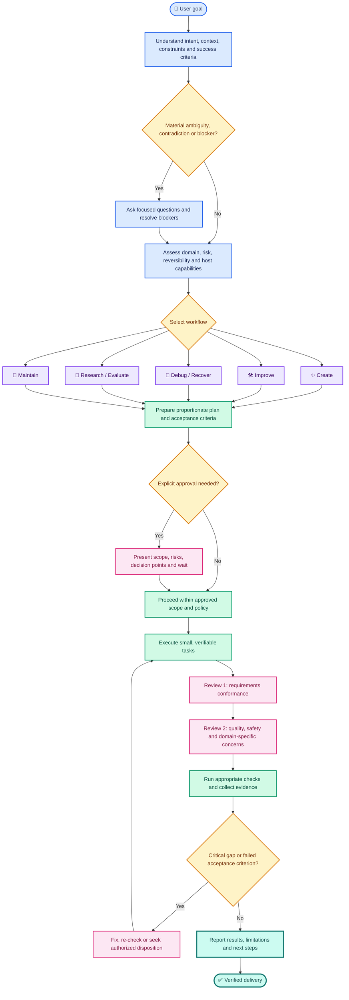

<div align="center">

# Master Agentic Creation Skill

### One adaptive workflow. Multiple creation domains. Evidence-driven delivery.

[](#release-status)
[](#how-it-works)
[](#safety-and-approval-model)
[](#portability)

**A portable, modular agent-skill framework for turning goals into understood, approved, executed, and verified outcomes.**

Research an idea. Create an artifact. Improve a project. Debug a failure. Maintain a solution.
The skill selects the appropriate workflow rather than forcing every task through one rigid process.

</div>

---

## ✨ Why this skill exists

Agentic work can fail when an agent starts too soon, assumes missing requirements, changes more than was approved, trusts unreviewed tools, or declares success without evidence. The **Master Agentic Creation Skill** provides a reusable operating contract for making that work more deliberate, auditable, and adaptable.

It is **not** a specific AI model, autonomous platform, simulator, or executable application. It is a modular set of instructions, workflows, templates, and test scenarios that a compatible AI-agent host can use to guide work.

### At a glance

| Capability | What it means in practice |
|---|---|
| 🧭 Adaptive routing | Selects the best-fit workflow based on intent, domain, ambiguity, risk, reversibility, dependencies, and available host capabilities. |
| 🗺️ Proportionate planning | Uses a lightweight path for simple tasks and a deeper plan for complex, costly, high-risk, or hard-to-reverse work. |
| 🛑 Approval gates | Requests explicit approval before consequential actions and material changes to approved scope. |
| 🧱 Milestone execution | Breaks nontrivial work into small, reviewable tasks with observable checkpoints. |
| 🔎 Two-pass review | Separately reviews requirements conformance and overall quality, with domain-specific checks. |
| 🧪 Evidence-based verification | Distinguishes checks that passed from checks that failed, were skipped, or were never run. |
| 🛡️ Trust-aware extensions | Assesses third-party skills, tools, scripts, plugins, dependencies, and integrations before use. |
| 🧠 Governed memory | Separates session context, project memory, approved preferences, and reusable knowledge. |
| 🔌 Host adapters | Detects actual host capabilities and uses safe fallbacks rather than pretending unsupported controls exist. |
| 📦 Release discipline | Includes test scenarios, evaluation guidance, release checklists, changelog guidance, and rollback expectations. |

## 🧭 How it works

The skill uses a modular router and a shared delivery lifecycle. It loads the workflow and references relevant to the current task, rather than dumping every module into context.



> **Important:** approval prompts, isolation, permissions, memory boundaries, and other controls are instructions unless the host actually enforces them. The skill must report the host's real capabilities and limitations honestly.

## 🧩 Workflow modules

| Module | Use it for | File |
|---|---|---|
| **Create** | Produce a new artifact, product, process, or solution. | [`workflows/create.md`](workflows/create.md) |
| **Improve** | Refine or extend an existing artifact or project. | [`workflows/improve.md`](workflows/improve.md) |
| **Debug / Recover** | Diagnose unexpected behavior, identify root causes, and recover safely. | [`workflows/debug-recover.md`](workflows/debug-recover.md) |
| **Research / Evaluate** | Research a question, compare options, validate claims, or assess an idea. | [`workflows/research-evaluate.md`](workflows/research-evaluate.md) |
| **Maintain** | Review, update, operate, or maintain an existing solution. | [`workflows/maintain.md`](workflows/maintain.md) |

All workflows share a consistent lifecycle: understand → resolve blockers → choose → plan → approve when required → execute → review → verify → converge → report.

## 🚀 Installation

The package is designed to be portable, but **installation is host-specific**. The following instructions cover Claude Code. For another agent host, use that host's documented skill or instruction mechanism and verify compatibility before relying on the workflow.

### Option A — Install for Claude Code across your projects

This makes the skill available from your personal Claude Code skill directory. Claude Code documents personal skills under `~/.claude/skills/` and project skills under `.claude/skills/`; see the [official Skills documentation](https://code.claude.com/docs/en/skills).

1. Download `Master_Agentic_Creation_Skill_V2_RC1.zip` from the release package.
2. Extract it. From a terminal in the directory containing the ZIP, run:

   ```bash
   mkdir -p /tmp/master-agentic-creation-v2
   unzip Master_Agentic_Creation_Skill_V2_RC1.zip -d /tmp/master-agentic-creation-v2
   ```

3. Install the **complete package**, not only `SKILL.md`. The core file refers to supporting modules by relative path.

   ```bash
   mkdir -p "$HOME/.claude/skills/master-agentic-creation"
   cp -a /tmp/master-agentic-creation-v2/. "$HOME/.claude/skills/master-agentic-creation/"
   ```

4. Start or reload a Claude Code session, then verify that this file exists:

   ```bash
   test -s "$HOME/.claude/skills/master-agentic-creation/SKILL.md" \
     && echo "Skill file found"
   ```

5. Invoke it with `/master-agentic-creation` or ask Claude Code to use the skill for a relevant task. Host behavior can vary by version and configuration; see [Claude Code Skills documentation](https://code.claude.com/docs/en/skills) if it does not appear.

**Where the ZIP is located:** if the archive is not in your current directory, replace `Master_Agentic_Creation_Skill_V2_RC1.zip` with its actual path. You can remove the temporary extraction directory after installation.

### Option B — Install only in one repository

Use project scope when you want the skill versioned alongside a specific team's code. From the target repository root, after extracting the release ZIP as above:

```bash
mkdir -p .claude/skills/master-agentic-creation
cp -a /tmp/master-agentic-creation-v2/. .claude/skills/master-agentic-creation/
```

Review the copied files before committing them. Commit `.claude/skills/` only if the repository's trust and contribution policies allow it. The skill's installation does not give it additional permissions beyond those available to the host agent.

### Option C — Use a different agent host

1. Read that host's current documentation for its skill, instruction, or agent extension mechanism.
2. Determine where it expects the entry file and supporting resources.
3. Adapt packaging and metadata if necessary; preserve the relative module structure or update references accordingly.
4. Build a capability profile using [`adapters/capability-profile-template.md`](adapters/capability-profile-template.md).
5. Run the portability scenarios in [`tests/portability-tests.md`](tests/portability-tests.md) and disclose any unsupported behavior.

Do **not** assume that every host supports the same metadata, automatic activation, slash-command invocation, shell tools, subagents, approval enforcement, sandboxing, or persistent memory. The skill is portable guidance; an adapter and host test are needed for dependable host-specific operation.

## 💬 How to use it

After installation, either invoke the skill directly when your host supports direct invocation, or describe your task clearly and let the host select it when relevant.

### Example prompts

**Create something new**

> `/master-agentic-creation` — Help me design a secure, production-ready FastAPI service with PostgreSQL. Start by identifying requirements and blockers, then present the plan and acceptance criteria before implementation.

**Improve an existing project**

> Use the Master Agentic Creation Skill to review this repository and propose the highest-value improvements. Inspect existing changes first, separate findings from proposed edits, and wait for approval before material changes.

**Debug a failure**

> Use the skill's debug/recover workflow to investigate these service errors. Establish a baseline, identify likely root causes with evidence, propose low-risk tests, and do not apply destructive or production-impacting changes without approval.

**Research and evaluate options**

> Use the research/evaluate workflow to compare three open-source observability stacks for an on-premises environment. State assumptions, cite sources, compare trade-offs, and distinguish verified facts from recommendations.

**Maintain an existing solution**

> Use the maintain workflow to plan a dependency update. Check compatibility, security advisories, rollback options, and tests before asking me to approve the change.

**Create a reusable artifact**

> Use the skill to prepare an ISO 27001 internal audit checklist for a defined scope. Make the deliverable traceable to stated requirements, identify evidence expectations, and clearly flag items that still need expert review.

### Tips for better results

- State the desired outcome and how you will recognize success.
- Name important constraints: environment, budget, standards, deadline, audience, or permitted tools.
- Share only the context and files needed for the task; avoid secrets and unnecessary personal or production data.
- For high-impact work, ask for a plan and acceptance criteria before authorizing implementation.
- Ask for a final report that separates **completed**, **verified**, **failed**, **not tested**, and **remaining** items.

The skill should ask focused questions when an answer could materially change the outcome, risk, cost, or scope. It should not prolong simple, low-risk tasks with unnecessary interviews or documents.

## 🛡️ Safety and approval model

The skill uses a tiered approval policy. It should pause for explicit approval before actions such as:

- destructive or irreversible changes;
- production deployments or production-impacting changes;
- external publication, sending, or distribution;
- spending money or making paid commitments;
- connecting accounts, granting permissions, or changing access controls;
- transferring sensitive information outside its approved boundary;
- installing or enabling untrusted tools, plugins, dependencies, Skills, or integrations;
- materially reducing isolation or bypassing established controls;
- making material changes to approved scope, architecture, cost, risk, or commitments.

The primary agent remains responsible for scope, decisions, integration, verification, and reporting. Delegation is selective, not the default. Third-party instructions are treated as untrusted input until appropriately inspected.

### Evidence before completion

The skill's definition of done expects:

1. Approved acceptance criteria checked against evidence.
2. Requirements conformance review and a separate quality review.
3. Critical findings fixed or handled through a safe, authorized disposition.
4. Actual test outcomes distinguished from planned or unrun checks.
5. Remaining gaps, assumptions, limitations, and next steps disclosed.

This framework improves discipline; it does not guarantee that an AI agent will behave correctly or that its host enforces every rule. Apply your organization's policies and keep appropriate human oversight, especially for regulated, security-sensitive, or production work.

## 🧠 Memory and controlled learning

The skill distinguishes four layers:

- **Session context** — information used for the current task.
- **Project memory** — project-specific facts and decisions.
- **Approved preferences** — user-authorized reusable preferences.
- **Trusted reusable knowledge** — lessons approved for reuse across contexts.

Cross-project lessons should not be promoted automatically. The intended sequence is propose → sanitize → inspect for sensitive data → test → request approval → version → preserve rollback. Actual persistence, deletion, backup, export, restore, and isolation depend on the host; the skill must not claim support it cannot verify.

## 🏗️ Repository map

```text
master-agentic-creation-skill/
├── SKILL.md                       # Portable entry point and workflow router
├── README.md                      # This guide
├── CHANGELOG.md                   # Version and change history
├── LICENSE                        # Placeholder: license decision required
├── Agentic_Creation_Platform_Blueprint.md  # Separate blueprint; not implemented here
├── core/
│   ├── approval-policy.md
│   ├── requirements-and-planning.md
│   └── evidence-and-convergence.md
├── workflows/
│   ├── create.md
│   ├── improve.md
│   ├── debug-recover.md
│   ├── research-evaluate.md
│   └── maintain.md
├── references/
│   ├── requirements-and-planning.md
│   ├── security-and-trust.md
│   ├── verification-and-review.md
│   ├── memory-and-learning.md
│   └── host-portability.md
├── adapters/
│   ├── capability-profile-template.md
│   └── host-adapter-template.md
├── templates/                     # Specs, plans, decisions and reports
├── tests/                          # Acceptance, safety, behavioral and portability scenarios
└── VALIDATION_REPORT.md            # Structural checks and explicit limitations
```

### What the supporting directories do

| Directory | Purpose |
|---|---|
| `core/` | Shared contracts for approval, planning, and evidence convergence. |
| `workflows/` | Task-specific procedures loaded according to user intent. |
| `references/` | Security, review, memory, planning, and portability guidance. |
| `adapters/` | Templates for documenting real host capabilities and mapping host-specific behavior. |
| `templates/` | Reusable project artifacts, including requirement specs, project plans, task plans, decision records, milestones, and completion reports. |
| `tests/` | Scenario specifications and evaluation rubrics for acceptance, safety, behavior, portability, and release readiness. |

## 🧪 Testing and validation

The package separates structural package checks from behavioral tests of the Skill inside a live host.

- Read [`VALIDATION_REPORT.md`](VALIDATION_REPORT.md) for executed checks and known limitations.
- Use [`tests/acceptance-tests.md`](tests/acceptance-tests.md) for expected core behavior.
- Use [`tests/safety-tests.md`](tests/safety-tests.md) for approval and trust scenarios.
- Use [`tests/behavioral-regression.md`](tests/behavioral-regression.md) to compare behavior before and after instruction changes.
- Use [`tests/portability-tests.md`](tests/portability-tests.md) to assess a named host and version.
- Use [`tests/evaluation-rubric.md`](tests/evaluation-rubric.md) and [`tests/release-checklist.md`](tests/release-checklist.md) when preparing a release.

**Test honesty matters:** test scenarios in Markdown are specifications, not evidence that those tests have run. Record the host/version, scenario, expected outcome, observed outcome, evidence, failures, and untested areas when executing evaluations.

## 🧱 Design principles

- **Portable core, specialized modules.** Keep common rules stable and host-specific behavior behind documented adapters.
- **Plan to the risk.** Avoid both careless execution and unnecessary bureaucracy.
- **Human approval at consequential boundaries.** Approval is scoped and must be renewed when material scope changes occur.
- **Evidence over confidence.** Do not equate a plausible explanation with a verified result.
- **Least privilege and trust boundaries.** Inspect unfamiliar instructions and extensions before enabling them.
- **Reviewable progress.** Make complex work visible through small checkpoints and concise status reports.
- **Governed improvement.** Test proposed reusable lessons and obtain authorization before promotion.

## 🗺️ Roadmap to a stable release

Before calling this candidate production-ready for a particular environment:

1. Review the full `SKILL.md` and supporting modules.
2. Choose a license and replace the `LICENSE` placeholder with the complete license text before public redistribution.
3. Install into each intended host using its documented mechanism.
4. Run the behavioral, safety, and portability scenarios on named host versions.
5. Record actual results, limitations, and any required adapter changes.
6. Review and approve the candidate, update the changelog/version, and preserve a rollback path.

## 📌 Release status

**Current package: `2.0.0-rc.1` — release candidate, not a final stable release.**

The local validation report records **14/14 structural/package checks passed** for this candidate, including Markdown structure, internal module references, ZIP integrity, and preservation of the separate platform blueprint. These checks do **not** prove runtime behavior.

Not yet completed: live behavioral regression testing in Claude Code or another host, host-specific compatibility verification, runtime enforcement tests for permissions/sandboxing/approval/memory isolation, and production deployment/performance testing of the separate platform.

The `LICENSE` file is a placeholder. Do not represent the package as licensed under an open-source license until a license is selected and its full text is present.

## 🤝 Contributing or customizing

For a local customization, keep the portable core small and put domain-specific procedures in the appropriate workflow or reference module. Add a behavioral scenario for any change that materially affects decisions, approvals, or expected outputs. Review for contradictions, stale relative links, accidental secrets, and claims that exceed host capabilities. Update the changelog and validation evidence before presenting a new release candidate.

## 📄 Key files

- [`SKILL.md`](SKILL.md) — start here; core operating contract and router.
- [`CHANGELOG.md`](CHANGELOG.md) — release history.
- [`VALIDATION_REPORT.md`](VALIDATION_REPORT.md) — what was checked and what remains untested.
- [`Agentic_Creation_Platform_Blueprint.md`](Agentic_Creation_Platform_Blueprint.md) — separate platform blueprint preserved in this package; the platform itself is not implemented by the Skill.

<div align="center">

**Start with the goal. Choose the right workflow. Approve consequential changes. Verify with evidence.**

</div>
